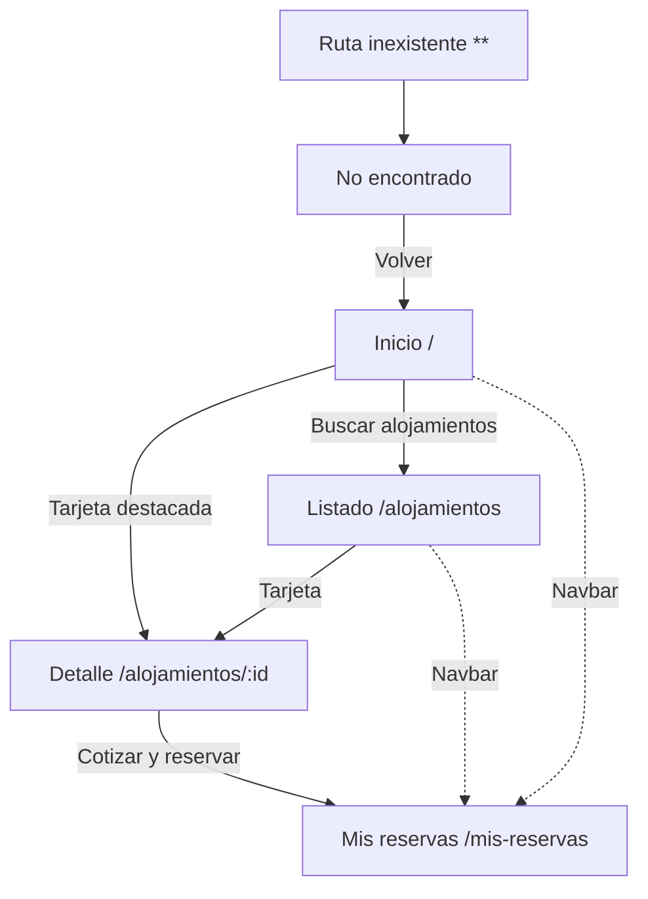

# Estructura de navegación

## Rutas de la aplicación

| Ruta | Componente | Se llega desde |
|------|------------|----------------|
| / | Inicio | Navbar (Inicio) |
| /alojamientos | AlojamientoLista | Navbar, botón del Inicio, enlace en Mis reservas vacío |
| /alojamientos/:id | AlojamientoDetalle | Tarjeta de alojamiento (Inicio o listado) |
| /mis-reservas | MisReservas | Navbar, enlace de confirmación de la reserva |
| ** | NoEncontrado | Cualquier ruta que no exista |

La ruta ** va siempre al final de la lista de rutas.

## Diagrama

## Estructura de la pantalla

La navegación está separada del contenido:

- app.html tiene el Navbar arriba, el contenido en el centro (router-outlet) y un footer.
- Al cambiar de ruta solo cambia el contenido del centro; el Navbar y el footer no cambian.

## Flujo principal del usuario

1. Entra al Inicio y pulsa buscar (o usa el menú Alojamientos).
2. Filtra y elige un alojamiento en el listado.
3. En el detalle ve la información y llena el cotizador.
4. Con la cotización válida pulsa Reservar y llena nombre y correo.
5. Se muestra la confirmación con el código y un enlace a Mis reservas.
